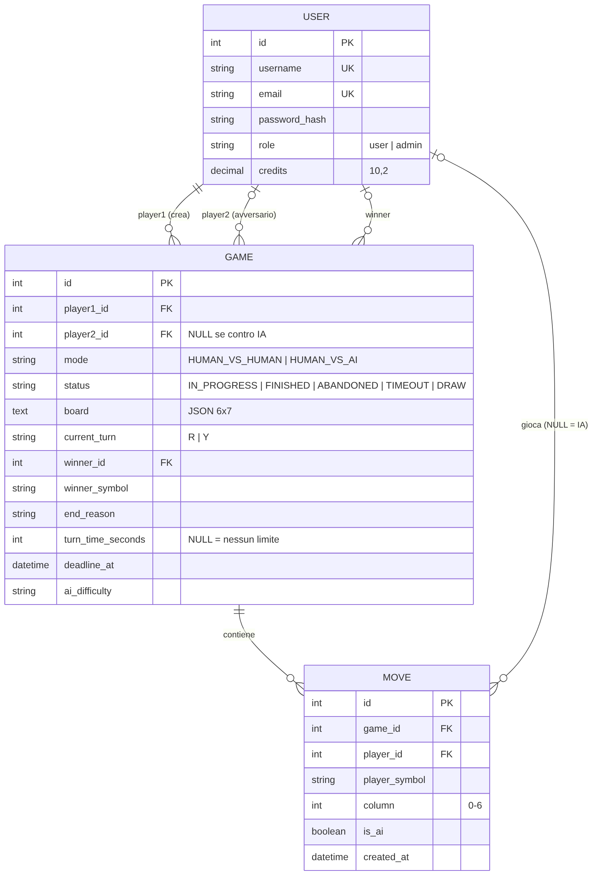
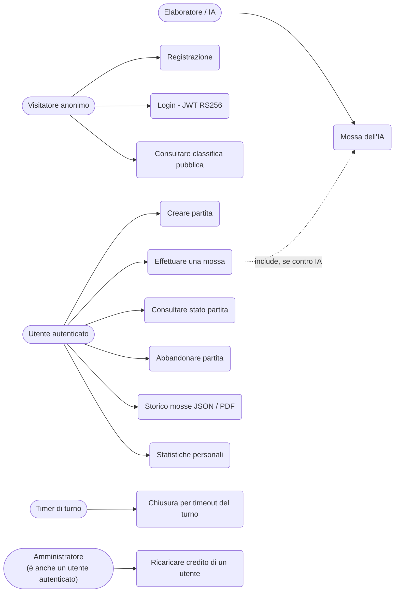
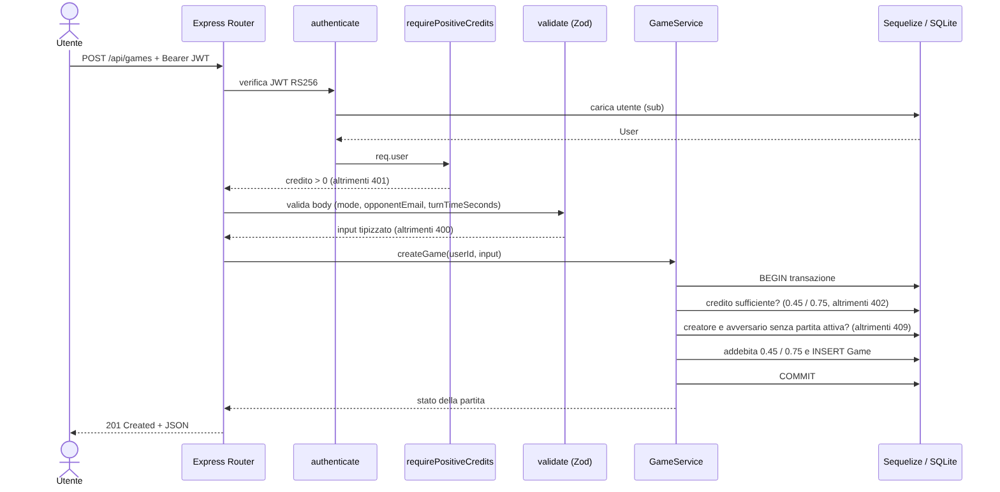
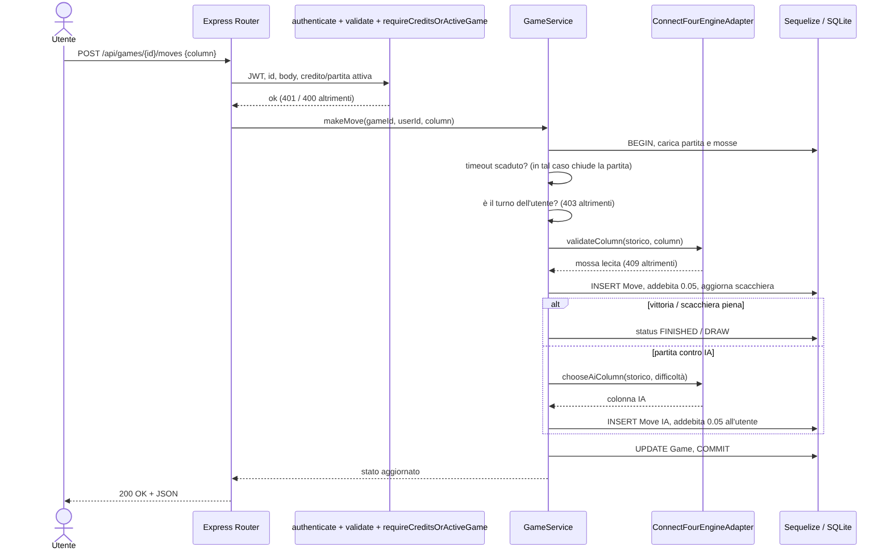
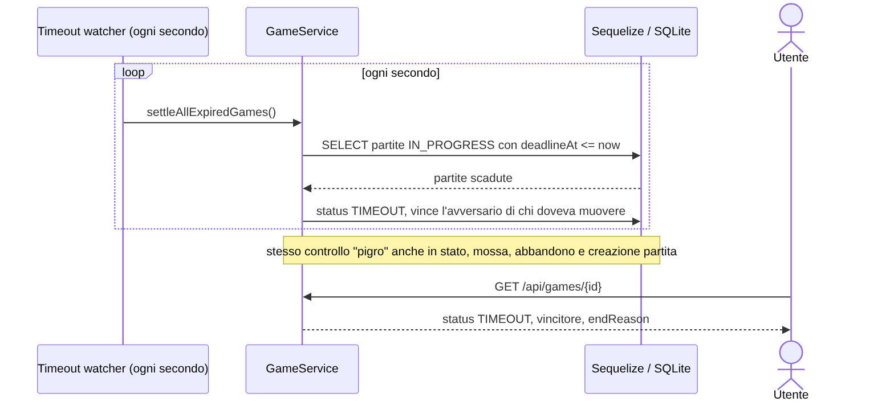
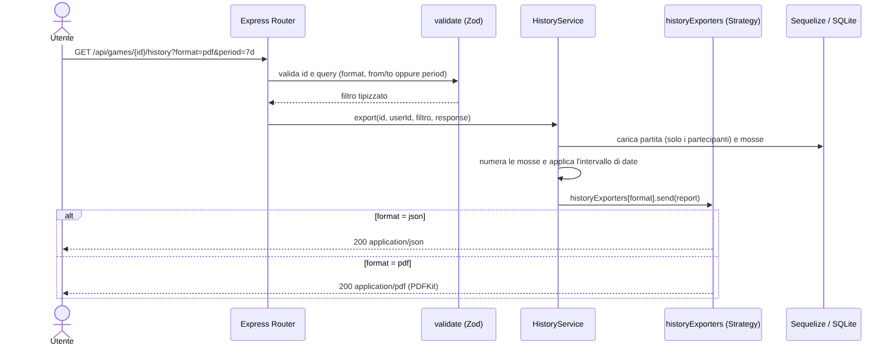

# Connect Four – Backend per FONDAMENTI DI INFORMATICA

REST API per l'esame di **FONDAMENTI DI INFORMATICA A.A. 2025/2026**, realizzata in **TypeScript** con **Express**, **Sequelize** e **SQLite**. Gestisce partite di Forza Quattro tra due utenti autenticati (JWT) oppure tra un utente e l'elaboratore (IA).

## Indice

1. [Obiettivo](#1-obiettivo)
2. [Tecnologie](#2-tecnologie)
3. [Progettazione](#3-progettazione)
4. [Diagrammi UML](#4-diagrammi-uml)
5. [Design pattern](#5-design-pattern)
6. [Avvio del progetto](#6-avvio-del-progetto)
7. [Utenti di esempio e password](#7-utenti-di-esempio-e-password)
8. [Crediti e regola 401](#8-crediti-e-regola-401)
9. [JWT e sicurezza](#9-jwt-e-sicurezza)
10. [API REST](#10-api-rest)
11. [Timeout del turno](#11-timeout-del-turno)
12. [Validazione e gestione errori](#12-validazione-e-gestione-errori)
13. [Test con Jest](#13-test-con-jest)
14. [Test con Postman](#14-test-con-postman)
15. [Scelte progettuali e limiti noti](#15-scelte-progettuali-e-limiti-noti)

## 1. Obiettivo

Realizzare un backend che consenta di:

- registrare utenti e autenticarli con **JWT firmati RS256**;
- creare partite **utente vs utente** e **utente vs IA**, con un tempo massimo opzionale per ogni mossa;
- permettere a un utente di partecipare a **una sola partita attiva** alla volta (più partite possono essere attive in contemporanea tra utenti diversi);
- validare le mosse, aggiornare la scacchiera e determinare vittoria, pareggio, abbandono o timeout;
- **addebitare crediti** secondo le tariffe del docente (0.45 / 0.75 alla creazione, 0.05 per ogni mossa, IA compresa);
- esportare lo **storico delle mosse** in JSON o PDF, filtrabile per intervallo di date o periodo;
- fornire una **classifica pubblica** (ordinabile) e le statistiche personali;
- consentire all'**amministratore** di ricaricare il credito di un utente.

## 2. Tecnologie

| Tecnologia | Utilizzo |
|---|---|
| Node.js 20+ / TypeScript | Runtime e linguaggio |
| Express | REST API e catena di middleware |
| Sequelize 6 + SQLite | ORM e RDBMS scelto |
| `connect4-ai` | Regole di gioco (validazione colonne) e mosse dell'IA (`easy` / `medium` / `hard`) |
| `jsonwebtoken` | JWT RS256 |
| `bcryptjs` | Hash delle password |
| Zod | Validazione di body, parametri e query |
| PDFKit | Esportazione PDF dello storico |
| Jest + ts-jest | Test automatici |
| Docker / Docker Compose | Avvio riproducibile |

## 3. Progettazione

Architettura a strati; ogni richiesta attraversa una catena di middleware prima di raggiungere il servizio:

```
Richiesta → authenticate (JWT) → controllo crediti / ruolo → validate (Zod) → route handler
                                                                                  │
                                                                      Service (logica di business)
                                                                                  │
                                                        Model Sequelize  /  Adapter del motore di gioco
                                                                                  │
                                      qualsiasi errore → errorHandler centrale → risposta JSON con codice HTTP
```

```
src/
├── app.ts / server.ts          bootstrap Express e watcher dei timeout
├── config/                     env.ts (caricamento .env), database.ts (Singleton)
├── routes/                     auth, games, leaderboard, stats, admin
├── middleware/                 auth, gameAccess, validate, errorHandler
├── services/                   AuthService, GameService, HistoryService, LeaderboardService, statsAggregator
├── exporters/                  strategie di esportazione dello storico (JSON, PDF)
├── game/                       ConnectFourEngineAdapter (Adapter verso connect4-ai)
├── models/                     User, Game, Move + associazioni
├── schemas/                    schemi Zod e tipi inferiti
└── utils/                      AppError, ErrorFactory, board, credits, dateRange, asyncHandler
scripts/                        seed.ts, generate-keys.js
tests/                          test Jest
docs/uml/                       diagrammi (sorgenti Mermaid .mmd + PNG)
postman/                        collection Postman
```

**Modello dati** (SQLite, tabelle `users`, `games`, `moves`): il saldo dei crediti è `DECIMAL(10,2)` nella tabella `users`; la scacchiera è salvata come JSON in `games.board`; la scadenza del turno in `games.deadline_at`.



## 4. Diagrammi UML

I sorgenti sono in `docs/uml/*.mmd` (Mermaid) e le immagini in `docs/uml/*.png`.

### Casi d'uso



### Sequenza – creazione di una partita



### Sequenza – esecuzione di una mossa (con risposta dell'IA)



### Sequenza – scadenza del turno



### Sequenza – esportazione dello storico



## 5. Design pattern

| Pattern | Dove | Perché è stato scelto |
|---|---|---|
| **Adapter** | `src/game/ConnectFourEngineAdapter.ts` (interfaccia `GameEnginePort`) | La libreria `connect4-ai` ha una propria API (`Connect4`, `Connect4AI`, `playAI`). L'adapter la traduce in due metodi stabili (`validateColumn`, `chooseAiColumn`): il resto del codice non dipende dalla libreria e il motore è sostituibile (ad es. con `versus-connect-four`) senza toccare servizi e rotte. Il motore viene ricostruito dallo storico delle mosse, quindi il database resta l'unica fonte di verità. |
| **Strategy** | `src/exporters/` (`HistoryExporter`, `JsonHistoryExporter`, `PdfHistoryExporter`) | Il formato di uscita dello storico (JSON/PDF) è un algoritmo intercambiabile scelto a runtime dal parametro `format`. `HistoryService` costruisce il report una sola volta; aggiungere un formato (CSV, XML) significa aggiungere una classe e una voce nel registro, senza `if/else` nel servizio (principio Open/Closed). |
| **Factory** | `src/utils/ErrorFactory.ts` | Centralizza la corrispondenza tra tipo di errore, codice HTTP e codice applicativo (`ErrorFactory.notFound(...)`, `.conflict(...)`, ...). Servizi e middleware sollevano errori coerenti e il middleware `errorHandler` li converte in risposte JSON. |
| **Singleton** | `src/config/database.ts` (`Database.getInstance()`) | Tutta l'applicazione condivide una sola istanza di Sequelize, quindi un solo file SQLite e un solo pool di connessioni, creato in modo lazy. |
| **Chain of Responsibility** | Pipeline di middleware Express | Autenticazione JWT → controllo crediti/ruolo → validazione Zod → handler. Ogni anello può interrompere la catena sollevando un errore o passare al successivo; le responsabilità restano separate e riusabili (`router.use(authenticate, requireAdmin)`). |
| **Service Layer** | `src/services/` | Isola la logica di business (crediti, turni, timeout, classifica) dalle rotte HTTP: le rotte sono sottili, i servizi sono testabili. La logica statistica pura è in `statsAggregator.ts` e quella sulle date in `dateRange.ts`, entrambe senza dipendenze dal database. |

## 6. Avvio del progetto

### 6.1 Con Docker Compose (consigliato)

Servono solo Docker e Docker Compose.

```bash
cp .env.example .env        # contiene le password di esempio: modificale se vuoi
docker compose up --build
```

All'avvio il container: **(1)** genera la coppia di chiavi RS256 se non esiste (viene salvata nel volume Docker in `/app/data/jwt-keys.env` e caricata con dotenv; se le chiavi sono già presenti in `.env` hanno la precedenza), **(2)** esegue il seed (idempotente), **(3)** avvia l'API su `http://localhost:3000`.

- Health check: `GET http://localhost:3000/health`
- Database e chiavi persistono nel volume `sqlite_data`; per ripartire da zero: `docker compose down -v`.

### 6.2 In locale

Prerequisiti: Node.js 20+ e npm.

```bash
cp .env.example .env
npm install
npm run generate:keys      # coppia RS256 scritta in .env (fatto in automatico da "npm run dev")
npm run seed               # crea admin, alice e bob
npm run dev                # sviluppo (ts-node-dev)
# oppure
npm run build && npm start
```

Comandi utili: `npm test`, `npm run typecheck`, `npm run seed:passwords` (rigenera l'hash delle password degli utenti di seed già esistenti dopo averle cambiate in `.env`).

### 6.3 Variabili d'ambiente (`.env`)

| Variabile | Significato |
|---|---|
| `PORT`, `DB_STORAGE` | Porta HTTP e percorso del file SQLite |
| `JWT_PRIVATE_KEY`, `JWT_PUBLIC_KEY` | Chiavi PEM RS256 (con `\n` escapati). La chiave privata resta solo lato server |
| `JWT_EXPIRES_IN` | Durata del token (default `2h`) |
| `INITIAL_CREDITS` | Credito iniziale assegnato dal seed e alla registrazione (default `10.00`) |
| `SEED_*_EMAIL`, `SEED_*_PASSWORD` | Account del seed (le password **non** sono scritte nel codice) |

## 7. Utenti di esempio e password

Il seed crea tre account, ciascuno con credito iniziale `INITIAL_CREDITS` (10.00):

| Ruolo | Email | Password |
|---|---|---|
| Admin | `admin@example.com` | `Adm1n!Forza4-Secure` |
| User | `alice@example.com` | `Al1ce!Forza4-Play` |
| User | `bob@example.com` | `B0b!Forza4-Play` |

Le password si cambiano in `.env` (`SEED_ADMIN_PASSWORD`, `SEED_ALICE_PASSWORD`, `SEED_BOB_PASSWORD`) e sono salvate nel database solo come hash bcrypt (12 round). Il seed non sovrascrive gli utenti esistenti, a meno di eseguire `npm run seed:passwords`.

**Politica password** (registrazione): da 8 a 72 caratteri, almeno una lettera e una cifra. La registrazione pubblica crea sempre il ruolo `user`; l'admin esiste solo tramite seed.

## 8. Crediti e regola 401

| Operazione | Addebito |
|---|---:|
| Creazione partita utente vs utente | 0.45 |
| Creazione partita utente vs IA | 0.75 |
| Ogni mossa di un utente | 0.05 |
| Ogni mossa dell'IA (addebitata all'utente che ha creato la partita) | 0.05 |

- Una partita può essere creata solo se il credito copre il costo di creazione (altrimenti `402`).
- Il saldo è nel database. Durante una partita può scendere sotto zero e si può continuare.
- In utente vs utente ogni giocatore paga le proprie mosse; la creazione è a carico di chi crea la partita.

**Utente senza crediti → `401 Unauthorized`.** Ogni richiesta autenticata di un utente con saldo ≤ 0 restituisce 401 (`requirePositiveCredits`), **tranne** stato, mossa e abbandono di una partita **ancora in corso di cui l'utente è giocatore** (`requireCreditsOrActiveGame`): è l'eccezione prevista dalle specifiche ("se il credito scende sotto zero durante la partita si può continuare"). Appena la partita finisce, anche queste rotte rispondono 401 finché l'admin non ricarica. Il login resta possibile, altrimenti un giocatore con token scaduto non potrebbe riprendere la sua partita.

**Ricarica admin** (`PUT /api/admin/credits`): `mode: "add"` (default) somma l'importo al saldo, `mode: "set"` imposta il saldo al valore indicato.

## 9. JWT e sicurezza

- Algoritmo **RS256**. Il payload applicativo contiene solo `sub` (id utente) e `role`; `iat`/`exp` sono i claim standard.
- Le chiavi sono in `.env` (o nel file indicato da `JWT_KEYS_FILE` in Docker) e vengono caricate da `src/config/env.ts`. Se manca la chiave pubblica viene derivata dalla privata.
- Il **ruolo effettivo è letto dal database**, non dal token: un utente declassato perde subito i privilegi.
- `.env` e `*.pem` sono esclusi da Git e dall'immagine Docker; il container gira con utente non privilegiato.
- Lo stato di una partita mostra solo il **proprio** saldo (`yourCredits`), mai quello dell'avversario.

## 10. API REST

Gli endpoint protetti richiedono `Authorization: Bearer <JWT>` e `Content-Type: application/json`.

| Metodo | Endpoint | Accesso | Descrizione |
|---|---|---|---|
| GET | `/health` | Pubblico | Health check |
| POST | `/api/auth/register` | Pubblico | Registrazione (ruolo `user`) |
| POST | `/api/auth/login` | Pubblico | Login, restituisce il JWT |
| GET | `/api/auth/me` | JWT, saldo > 0 | Profilo e saldo |
| POST | `/api/games` | JWT, saldo > 0 | Crea una partita |
| GET | `/api/games` | JWT, saldo > 0 | Elenco sintetico delle proprie partite |
| GET | `/api/games/:id` | JWT giocatore | Stato: turno, scacchiera, vincitore, timer, mosse |
| POST | `/api/games/:id/moves` | JWT giocatore | Effettua una mossa |
| POST | `/api/games/:id/abandon` | JWT giocatore | Abbandona la partita |
| GET | `/api/games/:id/history` | JWT giocatore, saldo > 0 | Storico mosse in JSON o PDF |
| GET | `/api/leaderboard?order=asc\|desc` | **Pubblico** | Classifica in JSON |
| GET | `/api/stats/me` | JWT, saldo > 0 | Statistiche personali |
| PUT | `/api/admin/credits` | JWT admin | Ricarica il credito di un utente |

### Esempi

**Registrazione** – `POST /api/auth/register`
```json
{ "username": "carlo", "email": "carlo@example.com", "password": "StrongPass123!" }
```

**Login** – `POST /api/auth/login` → `{ "token": "...", "user": { "id": 2, "username": "alice", "role": "user", "credits": 10 } }`
```json
{ "email": "alice@example.com", "password": "Al1ce!Forza4-Play" }
```

**Partita contro IA** – `POST /api/games`
```json
{ "mode": "HUMAN_VS_AI", "turnTimeSeconds": 30, "aiDifficulty": "medium" }
```

**Partita contro un utente** – l'avversario deve essere registrato; la partita parte subito e lo coinvolge.
```json
{ "mode": "HUMAN_VS_HUMAN", "opponentEmail": "bob@example.com", "turnTimeSeconds": null }
```
`turnTimeSeconds` = `null` o omesso significa **nessun limite di tempo**; altrimenti un intero tra 5 e 3600.

**Mossa** – `POST /api/games/1/moves` con `{ "column": 3 }` (colonne da 0 a 6). Nelle partite contro IA la risposta contiene già anche la mossa dell'elaboratore.

**Stato** – `GET /api/games/1` restituisce giocatori, scacchiera 6×7, `currentTurn`/`currentPlayer`, `isYourTurn`, `status`, `winner`, `endReason`, `remainingSeconds`, `yourCredits` e l'elenco numerato delle mosse.

**Abbandono** – `POST /api/games/1/abandon`: l'avversario (o il computer) vince "per abbandono".

**Storico** – `GET /api/games/1/history` con:

| Parametro | Valori |
|---|---|
| `format` | `json` (default) o `pdf` |
| `from`, `to` | data inferiore / superiore ISO‑8601 (inclusive), usabili anche singolarmente |
| `period` | ultimo periodo: `<n>h`, `<n>d` o `<n>w` (es. `24h`, `7d`, `2w`); non combinabile con `from`/`to` |

```http
GET /api/games/1/history?format=pdf
GET /api/games/1/history?format=json&period=7d
GET /api/games/1/history?format=json&from=2026-06-01T00:00:00Z&to=2026-06-30T23:59:59Z
```
Il numero d'ordine di ogni mossa (`moveNumber`) è quello reale nella partita anche quando il filtro esclude le mosse precedenti.

**Classifica pubblica** – `GET /api/leaderboard?order=desc` (o `asc`). Per ogni utente: `score` (= vittorie + vittorie per abbandono) e, separatamente per le partite contro **utenti reali** (`human`) e contro l'**IA** (`ai`), oltre al `total`: `played`, `wins`, `winsByAbandonment`, `losses`, `lossesByAbandonment`, `draws`.
La scadenza del tempo (timeout) è assimilata all'abbandono: chi non muove in tempo perde "per abbandono" e l'avversario vince "per abbandono".

**Ricarica admin** – `PUT /api/admin/credits`
```json
{ "email": "alice@example.com", "credits": 5.00, "mode": "add" }
```
```json
{ "email": "alice@example.com", "credits": 25.50, "mode": "set" }
```

## 11. Timeout del turno

Se `turnTimeSeconds` è impostato, `deadlineAt` viene salvato nel database all'inizio di ogni turno e ricalcolato dopo ogni mossa. Un job del server controlla ogni secondo le partite scadute; lo stesso controllo viene fatto "al volo" quando si legge una partita, si muove, si abbandona o si crea una partita. Allo scadere la partita passa a `TIMEOUT` e vince l'avversario di chi doveva muovere. Essendo salvata nel DB, la scadenza sopravvive al riavvio del processo.

## 12. Validazione e gestione errori

Gli schemi Zod (`.strict()`, quindi campi sconosciuti rifiutati) validano body, parametri e query. Tutti gli errori vengono sollevati con `ErrorFactory` e gestiti dal middleware centrale `errorHandler`, che risponde `{ "error": "<codice>", "message": "...", "details"?: ... }`.

| Codice | Quando |
|---|---|
| `400` | Input non valido, JSON malformato, giocare contro se stessi |
| `401` | JWT mancante/non valido/scaduto, credito esaurito, credenziali errate |
| `402` | Credito insufficiente per creare la partita |
| `403` | Non partecipante, non è il tuo turno, ruolo insufficiente |
| `404` | Partita, utente o rotta inesistente |
| `409` | Utente già in una partita attiva, colonna piena, partita già conclusa |
| `413` / `500` | Body troppo grande / errore interno (senza dettagli verso il client) |

Le operazioni che modificano più tabelle (creazione, mossa, abbandono) sono eseguite in **transazioni**: in caso di errore nulla viene addebitato né salvato.

## 13. Test con Jest

```bash
npm test                 # tutti i test
npm run test:coverage    # con coverage
```

| File | Cosa verifica |
|---|---|
| `authMiddleware.test.ts` | **Middleware `authenticate`**: token assente, valido (RS256), scaduto, firmato con chiave diversa, utente inesistente. **`requireAdmin`** e **`requirePositiveCredits`** (401 a saldo 0) |
| `gameAccess.test.ts` | **Middleware `requireCreditsOrActiveGame`**: eccezione per la partita in corso, 401 a partita finita o per non partecipanti |
| `board.test.ts` | Regole di gioco: vittorie orizzontale, verticale, diagonale, colonne piene/non valide, scacchiera piena |
| `statsAggregator.test.ts` | Classifica: vittorie/sconfitte, per abbandono/timeout, pareggi, punteggio, separazione umano/IA |
| `dateRange.test.ts` | Filtri `from` / `to` / `period` dello storico |
| `schemas.test.ts` | Validazione richieste (partita, password, ricarica admin, storico) |
| `credits.test.ts` | Tariffe e arrotondamento dei crediti |
| `historyExporter.test.ts` | Strategia JSON e registro dei formati |

## 14. Test con Postman

Importare `postman/Connect-Four-Exam.postman_collection.json` (variabili di collezione: `baseUrl`, `userToken`, `bobToken`, `adminToken`, `gameId`, `opponentEmail`). Ordine consigliato:

1. `Health`, poi **login** di Alice, Bob e Admin: gli script di test salvano i JWT nelle variabili;
2. partita contro IA: **Create Human vs AI** → **Make move** → **Get game state** → storico JSON/PDF → **Abandon**;
3. partita utente vs utente: **Create Human vs Human** (come Alice), mosse alternate Alice/Bob;
4. **leaderboard** (senza token) in ordine crescente e decrescente, **My statistics**;
5. **Admin recharge** in modalità `add` e `set`.

Per provare la regola dei crediti: portare a 0 il saldo di un utente con `mode: "set"` e verificare il `401` su `GET /api/games`, mentre una partita già in corso resta giocabile.

## 15. Scelte progettuali e limiti noti

- **Nessuna accettazione dell'invito**: in utente vs utente la partita parte subito e l'avversario (identificato dall'email) è coinvolto senza conferma, come previsto dalla traccia. Per questo l'avversario deve essere libero (nessuna altra partita attiva).
- `sequelize.sync()` crea le tabelle all'avvio; in produzione si userebbero le migrazioni.
- SQLite è adatto a questo contesto didattico; per carichi elevati si userebbe PostgreSQL/MySQL cambiando solo la configurazione di Sequelize.
- Non è presente rate limiting; in produzione si aggiungerebbero anche HTTPS e rotazione delle chiavi.
- Le password di esempio nel repository servono solo alla prova dell'esame: vanno cambiate per qualunque uso reale.
