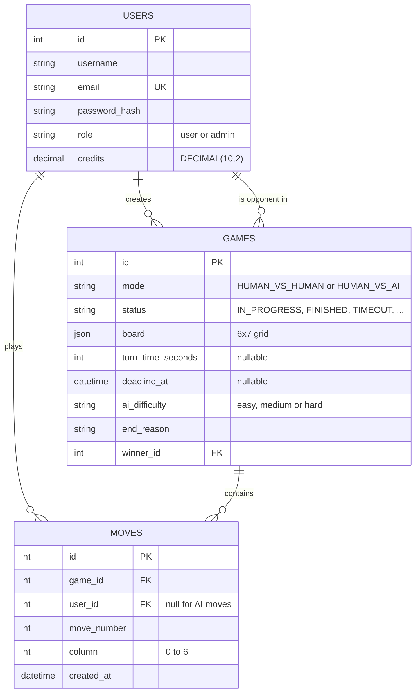
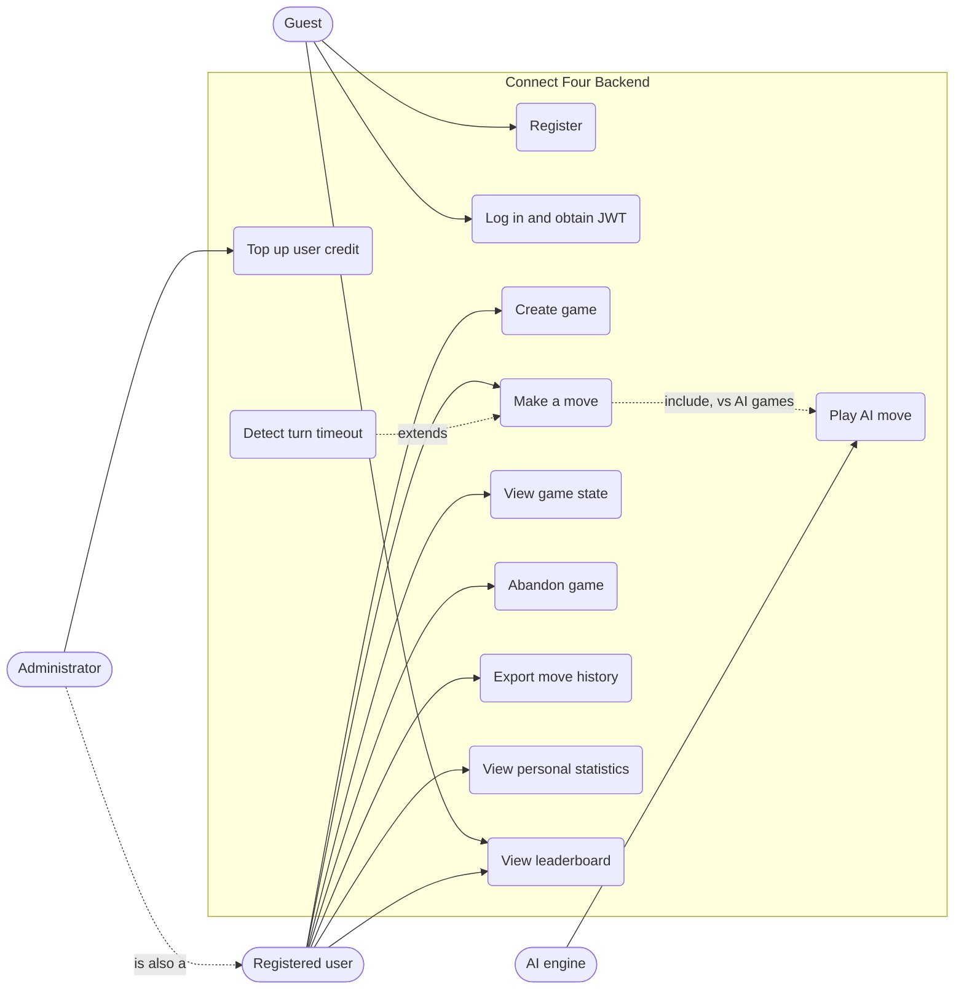
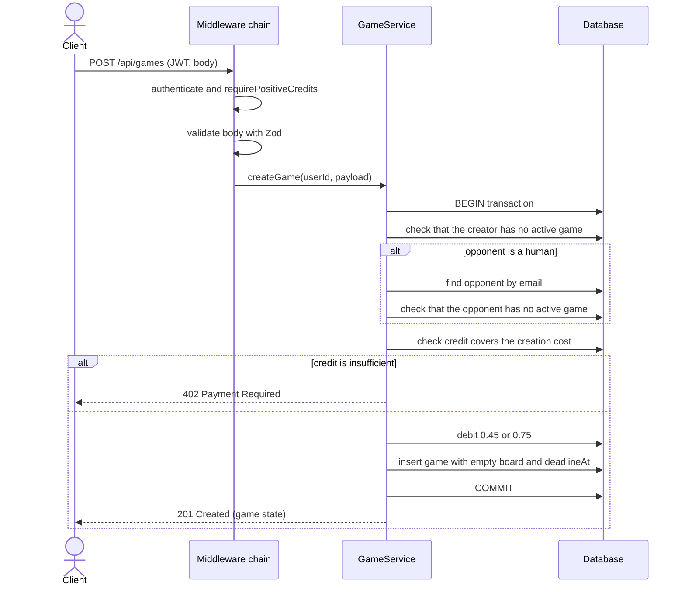
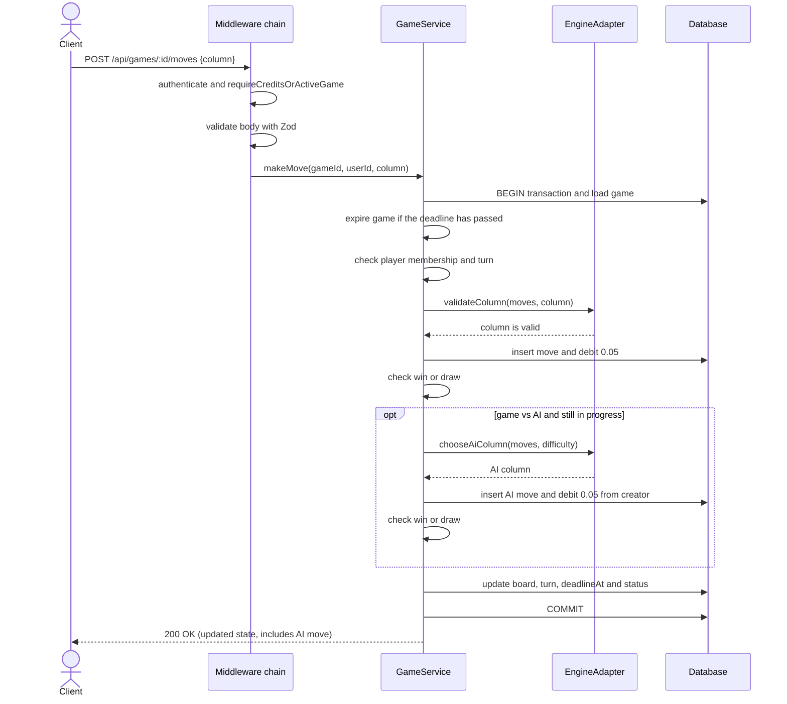
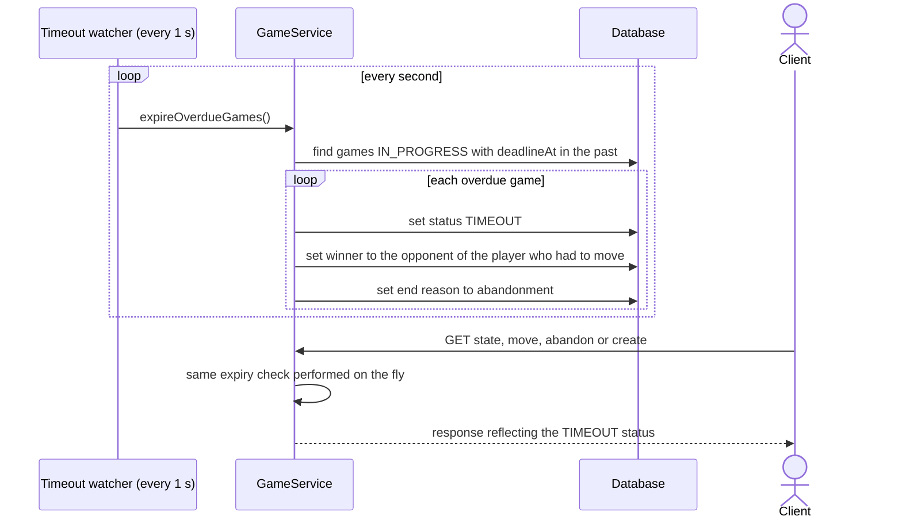
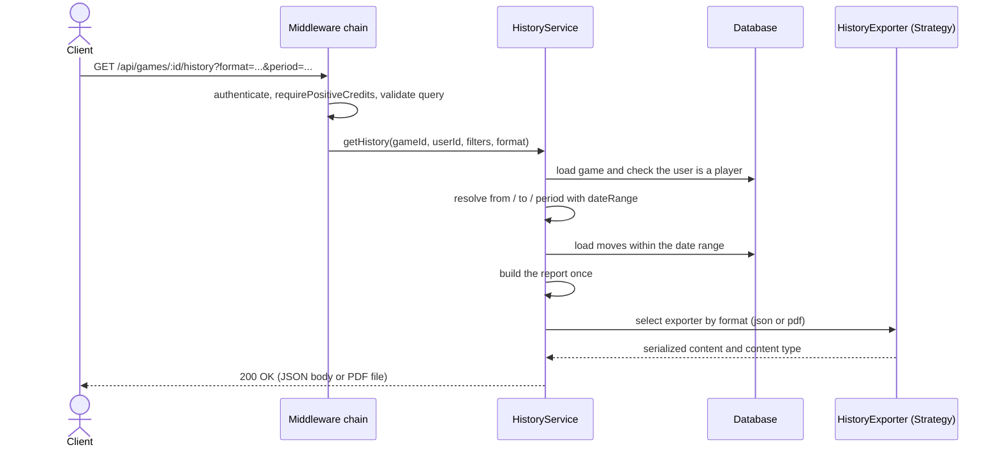

# Connect Four 

REST API for the **FONDAMENTI DI INFORMATICA exam, academic year 2025/2026**, built with **TypeScript**, **Express**, **Sequelize** and **SQLite**. It manages Connect Four games between two authenticated users (JWT) or between a user and the computer (AI).

## Table of Contents

1. [Goal](#1-goal)
2. [Technologies](#2-technologies)
3. [Design](#3-design)
4. [UML Diagrams](#4-uml-diagrams)
5. [Design Patterns](#5-design-patterns)
6. [Getting Started](#6-getting-started)
7. [Sample Users and Passwords](#7-sample-users-and-passwords)
8. [Credits and the 401 Rule](#8-credits-and-the-401-rule)
9. [JWT and Security](#9-jwt-and-security)
10. [REST API](#10-rest-api)
11. [Turn Timeout](#11-turn-timeout)
12. [Validation and Error Handling](#12-validation-and-error-handling)
13. [Testing with Jest](#13-testing-with-jest)
14. [Testing with Postman](#14-testing-with-postman)
15. [Design Choices and Known Limitations](#15-design-choices-and-known-limitations)

## 1. Goal

Build a backend that allows you to:

- register users and authenticate them with **JWTs signed with RS256**;
- create **user vs user** and **user vs AI** games, with an optional maximum time for each move;
- let a user take part in **only one active game** at a time (several games can be active at once between different users);
- validate moves, update the board and determine a win, draw, abandonment or timeout;
- **charge credits** according to the instructor's rates (0.45 / 0.75 on creation, 0.05 for every move, AI moves included);
- export the **move history** as JSON or PDF, filterable by date range or period;
- provide a **public leaderboard** (sortable) and personal statistics;
- allow the **administrator** to top up a user's credit.

## 2. Technologies

| Technology | Usage |
|---|---|
| Node.js 20+ / TypeScript | Runtime and language |
| Express | REST API and middleware chain |
| Sequelize 6 + SQLite | ORM and chosen RDBMS |
| `connect4-ai` | Game rules (column validation) and AI moves (`easy` / `medium` / `hard`) |
| `jsonwebtoken` | RS256 JWTs |
| `bcryptjs` | Password hashing |
| Zod | Validation of body, parameters and query |
| PDFKit | PDF export of the history |
| Jest + ts-jest | Automated tests |
| Docker / Docker Compose | Reproducible startup |

## 3. Design

Layered architecture; every request goes through a chain of middleware before reaching the service:

```
Request → authenticate (JWT) → credit / role check → validate (Zod) → route handler
                                                                           │
                                                               Service (business logic)
                                                                           │
                                                 Sequelize model  /  Game engine adapter
                                                                           │
                            any error → central errorHandler → JSON response with HTTP code
```

```
src/
├── app.ts / server.ts          Express bootstrap and timeout watcher
├── config/                     env.ts (.env loading), database.ts (Singleton)
├── routes/                     auth, games, leaderboard, stats, admin
├── middleware/                 auth, gameAccess, validate, errorHandler
├── services/                   AuthService, GameService, HistoryService, LeaderboardService, statsAggregator
├── exporters/                  history export strategies (JSON, PDF)
├── game/                       ConnectFourEngineAdapter (Adapter for connect4-ai)
├── models/                     User, Game, Move + associations
├── schemas/                    Zod schemas and inferred types
└── utils/                      AppError, ErrorFactory, board, credits, dateRange, asyncHandler
scripts/                        seed.ts, generate-keys.js
tests/                          Jest tests
postman/                        Postman collection
```

**Data model** (SQLite, tables `users`, `games`, `moves`): the credit balance is a `DECIMAL(10,2)` in the `users` table; the board is stored as JSON in `games.board`; the turn deadline is in `games.deadline_at`.



## 4. UML Diagrams

All diagrams are written as text in [Mermaid](https://mermaid.js.org/) syntax directly inside this file, so they are rendered automatically by GitHub and stay versioned together with the code.

### Use cases



### Sequence – game creation



### Sequence – making a move (with AI reply)



### Sequence – turn timeout



### Sequence – history export



## 5. Design Patterns

| Pattern | Where | Why it was chosen |
|---|---|---|
| **Adapter** | `src/game/ConnectFourEngineAdapter.ts` (interface `GameEnginePort`) | The `connect4-ai` library has its own API (`Connect4`, `Connect4AI`, `playAI`). The adapter translates it into two stable methods (`validateColumn`, `chooseAiColumn`): the rest of the code does not depend on the library and the engine can be replaced (e.g. with `versus-connect-four`) without touching services and routes. The engine is rebuilt from the move history, so the database remains the single source of truth. |
| **Strategy** | `src/exporters/` (`HistoryExporter`, `JsonHistoryExporter`, `PdfHistoryExporter`) | The history output format (JSON/PDF) is an interchangeable algorithm chosen at runtime from the `format` parameter. `HistoryService` builds the report once; adding a format (CSV, XML) means adding a class and an entry in the registry, with no `if/else` in the service (Open/Closed principle). |
| **Factory** | `src/utils/ErrorFactory.ts` | Centralizes the mapping between error type, HTTP code and application code (`ErrorFactory.notFound(...)`, `.conflict(...)`, ...). Services and middleware raise consistent errors and the `errorHandler` middleware converts them into JSON responses. |
| **Singleton** | `src/config/database.ts` (`Database.getInstance()`) | The whole application shares a single Sequelize instance, hence a single SQLite file and a single connection pool, created lazily. |
| **Chain of Responsibility** | Express middleware pipeline | JWT authentication → credit/role check → Zod validation → handler. Each link can break the chain by raising an error or pass to the next; responsibilities stay separate and reusable (`router.use(authenticate, requireAdmin)`). |
| **Service Layer** | `src/services/` | Isolates business logic (credits, turns, timeouts, leaderboard) from the HTTP routes: routes are thin, services are testable. Pure statistics logic lives in `statsAggregator.ts` and date logic in `dateRange.ts`, both with no database dependency. |

## 6. Getting Started

### 6.1 With Docker Compose (recommended)

Only Docker and Docker Compose are required.

```bash
cp .env.example .env        # contains the sample passwords: change them if you want
docker compose up --build
```

On startup the container: **(1)** generates the RS256 key pair if it does not exist (it is saved in the Docker volume at `/app/data/jwt-keys.env` and loaded with dotenv; if keys are already present in `.env` they take precedence), **(2)** runs the seed (idempotent), **(3)** starts the API on `http://localhost:3000`.

- Health check: `GET http://localhost:3000/health`
- The database and keys persist in the `sqlite_data` volume; to start from scratch: `docker compose down -v`.

### 6.2 Locally

Prerequisites: Node.js 20+ and npm.

```bash
cp .env.example .env
npm install
npm run generate:keys      # RS256 pair written to .env (done automatically by "npm run dev")
npm run seed               # creates admin, alice and bob
npm run dev                # development (ts-node-dev)
# or
npm run build && npm start
```

Useful commands: `npm test`, `npm run typecheck`, `npm run seed:passwords` (regenerates the password hashes of already existing seed users after changing them in `.env`).

### 6.3 Environment variables (`.env`)

| Variable | Meaning |
|---|---|
| `PORT`, `DB_STORAGE` | HTTP port and path of the SQLite file |
| `JWT_PRIVATE_KEY`, `JWT_PUBLIC_KEY` | RS256 PEM keys (with escaped `\n`). The private key stays on the server only |
| `JWT_EXPIRES_IN` | Token lifetime (default `2h`) |
| `INITIAL_CREDITS` | Initial credit assigned by the seed and at registration (default `10.00`) |
| `SEED_*_EMAIL`, `SEED_*_PASSWORD` | Seed accounts (passwords are **not** written in the code) |

## 7. Sample Users and Passwords

The seed creates three accounts, each with an initial credit of `INITIAL_CREDITS` (10.00):

| Role | Email | Password |
|---|---|---|
| Admin | `admin@example.com` | `Adm1n!Forza4-Secure` |
| User | `alice@example.com` | `Al1ce!Forza4-Play` |
| User | `bob@example.com` | `B0b!Forza4-Play` |

Passwords are changed in `.env` (`SEED_ADMIN_PASSWORD`, `SEED_ALICE_PASSWORD`, `SEED_BOB_PASSWORD`) and are stored in the database only as bcrypt hashes (12 rounds). The seed does not overwrite existing users unless you run `npm run seed:passwords`.

**Password policy** (registration): 8 to 72 characters, at least one letter and one digit. Public registration always creates the `user` role; the admin exists only through the seed.

## 8. Credits and the 401 Rule

| Operation | Charge |
|---|---:|
| Creating a user vs user game | 0.45 |
| Creating a user vs AI game | 0.75 |
| Each user move | 0.05 |
| Each AI move (charged to the user who created the game) | 0.05 |

- A game can be created only if the credit covers the creation cost (otherwise `402`).
- The balance is stored in the database. During a game it can drop below zero and play can continue.
- In user vs user games each player pays for their own moves; creation is charged to whoever creates the game.

**User without credits → `401 Unauthorized`.** Every authenticated request from a user with a balance ≤ 0 returns 401 (`requirePositiveCredits`), **except** state, move and abandon on a game that is **still in progress and in which the user is a player** (`requireCreditsOrActiveGame`): this is the exception required by the specification ("if the credit drops below zero during the game, play can continue"). As soon as the game ends, these routes also answer 401 until the admin tops up the balance. Login remains possible, otherwise a player with an expired token could not resume their game.

**Admin top-up** (`PUT /api/admin/credits`): `mode: "add"` (default) adds the amount to the balance, `mode: "set"` sets the balance to the given value.

## 9. JWT and Security

- **RS256** algorithm. The application payload contains only `sub` (user id) and `role`; `iat`/`exp` are the standard claims.
- Keys are in `.env` (or in the file indicated by `JWT_KEYS_FILE` in Docker) and are loaded by `src/config/env.ts`. If the public key is missing it is derived from the private one.
- The **effective role is read from the database**, not from the token: a demoted user immediately loses their privileges.
- `.env` and `*.pem` are excluded from Git and from the Docker image; the container runs as an unprivileged user.
- A game's state shows only the user's **own** balance (`yourCredits`), never the opponent's.

## 10. REST API

Protected endpoints require `Authorization: Bearer <JWT>` and `Content-Type: application/json`.

| Method | Endpoint | Access | Description |
|---|---|---|---|
| GET | `/health` | Public | Health check |
| POST | `/api/auth/register` | Public | Registration (role `user`) |
| POST | `/api/auth/login` | Public | Login, returns the JWT |
| GET | `/api/auth/me` | JWT, balance > 0 | Profile and balance |
| POST | `/api/games` | JWT, balance > 0 | Create a game |
| GET | `/api/games` | JWT, balance > 0 | Summary list of your games |
| GET | `/api/games/:id` | JWT, player | State: turn, board, winner, timer, moves |
| POST | `/api/games/:id/moves` | JWT, player | Make a move |
| POST | `/api/games/:id/abandon` | JWT, player | Abandon the game |
| GET | `/api/games/:id/history` | JWT, player, balance > 0 | Move history as JSON or PDF |
| GET | `/api/leaderboard?order=asc\|desc` | **Public** | Leaderboard in JSON |
| GET | `/api/stats/me` | JWT, balance > 0 | Personal statistics |
| PUT | `/api/admin/credits` | JWT, admin | Top up a user's credit |

### Examples

**Registration** – `POST /api/auth/register`
```json
{ "username": "carlo", "email": "carlo@example.com", "password": "StrongPass123!" }
```

**Login** – `POST /api/auth/login` → `{ "token": "...", "user": { "id": 2, "username": "alice", "role": "user", "credits": 10 } }`
```json
{ "email": "alice@example.com", "password": "Al1ce!Forza4-Play" }
```

**Game against the AI** – `POST /api/games`
```json
{ "mode": "HUMAN_VS_AI", "turnTimeSeconds": 30, "aiDifficulty": "medium" }
```

**Game against a user** – the opponent must be registered; the game starts immediately and involves them.
```json
{ "mode": "HUMAN_VS_HUMAN", "opponentEmail": "bob@example.com", "turnTimeSeconds": null }
```
`turnTimeSeconds` = `null` or omitted means **no time limit**; otherwise an integer between 5 and 3600.

**Move** – `POST /api/games/1/moves` with `{ "column": 3 }` (columns 0 to 6). In games against the AI the response already includes the computer's move as well.

**State** – `GET /api/games/1` returns players, the 6×7 board, `currentTurn`/`currentPlayer`, `isYourTurn`, `status`, `winner`, `endReason`, `remainingSeconds`, `yourCredits` and the numbered list of moves.

**Abandon** – `POST /api/games/1/abandon`: the opponent (or the computer) wins "by abandonment".

**History** – `GET /api/games/1/history` with:

| Parameter | Values |
|---|---|
| `format` | `json` (default) or `pdf` |
| `from`, `to` | lower / upper ISO‑8601 date (inclusive), can also be used individually |
| `period` | most recent period: `<n>h`, `<n>d` or `<n>w` (e.g. `24h`, `7d`, `2w`); cannot be combined with `from`/`to` |

```http
GET /api/games/1/history?format=pdf
GET /api/games/1/history?format=json&period=7d
GET /api/games/1/history?format=json&from=2026-06-01T00:00:00Z&to=2026-06-30T23:59:59Z
```
The sequence number of each move (`moveNumber`) is its real position in the game, even when the filter excludes the earlier moves.

**Public leaderboard** – `GET /api/leaderboard?order=desc` (or `asc`). For each user: `score` (= wins + wins by abandonment) and, separately for games against **real users** (`human`) and against the **AI** (`ai`), in addition to the `total`: `played`, `wins`, `winsByAbandonment`, `losses`, `lossesByAbandonment`, `draws`.
A timeout is treated as an abandonment: whoever does not move in time loses "by abandonment" and the opponent wins "by abandonment".

**Admin top-up** – `PUT /api/admin/credits`
```json
{ "email": "alice@example.com", "credits": 5.00, "mode": "add" }
```
```json
{ "email": "alice@example.com", "credits": 25.50, "mode": "set" }
```

## 11. Turn Timeout

If `turnTimeSeconds` is set, `deadlineAt` is saved in the database at the start of each turn and recalculated after every move. A server job checks for expired games every second; the same check is also performed "on the fly" when a game is read, a move is made, a game is abandoned or a game is created. When time runs out the game moves to `TIMEOUT` and the opponent of the player who had to move wins. Because it is stored in the DB, the deadline survives a process restart.

## 12. Validation and Error Handling

Zod schemas (`.strict()`, so unknown fields are rejected) validate body, parameters and query. All errors are raised with `ErrorFactory` and handled by the central `errorHandler` middleware, which replies `{ "error": "<code>", "message": "...", "details"?: ... }`.

| Code | When |
|---|---|
| `400` | Invalid input, malformed JSON, playing against yourself |
| `401` | Missing/invalid/expired JWT, credit exhausted, wrong credentials |
| `402` | Insufficient credit to create the game |
| `403` | Not a participant, not your turn, insufficient role |
| `404` | Game, user or route does not exist |
| `409` | User already in an active game, column full, game already finished |
| `413` / `500` | Body too large / internal error (no details sent to the client) |

Operations that modify multiple tables (creation, move, abandon) run in **transactions**: on error nothing is charged or saved.

## 13. Testing with Jest

```bash
npm test                 # all tests
npm run test:coverage    # with coverage
```

| File | What it verifies |
|---|---|
| `authMiddleware.test.ts` | **`authenticate` middleware**: missing token, valid (RS256), expired, signed with a different key, non-existent user. **`requireAdmin`** and **`requirePositiveCredits`** (401 at zero balance) |
| `gameAccess.test.ts` | **`requireCreditsOrActiveGame` middleware**: exception for a game in progress, 401 when the game is over or for non-participants |
| `board.test.ts` | Game rules: horizontal, vertical and diagonal wins, full/invalid columns, full board |
| `statsAggregator.test.ts` | Leaderboard: wins/losses, by abandonment/timeout, draws, score, human/AI separation |
| `dateRange.test.ts` | History `from` / `to` / `period` filters |
| `schemas.test.ts` | Request validation (game, password, admin top-up, history) |
| `credits.test.ts` | Credit rates and rounding |
| `historyExporter.test.ts` | JSON strategy and format registry |

## 14. Testing with Postman

Import `postman/Connect-Four-Exam.postman_collection.json` (collection variables: `baseUrl`, `userToken`, `bobToken`, `adminToken`, `gameId`, `opponentEmail`). Recommended order:

1. `Health`, then **login** as Alice, Bob and Admin: the test scripts save the JWTs in the variables;
2. game against the AI: **Create Human vs AI** → **Make move** → **Get game state** → JSON/PDF history → **Abandon**;
3. user vs user game: **Create Human vs Human** (as Alice), alternating moves Alice/Bob;
4. **leaderboard** (without a token) in ascending and descending order, **My statistics**;
5. **Admin recharge** in `add` and `set` mode.

To try the credit rule: set a user's balance to 0 with `mode: "set"` and verify the `401` on `GET /api/games`, while a game already in progress remains playable.

## 15. Design Choices and Known Limitations

- **No invitation acceptance**: in user vs user games the game starts immediately and the opponent (identified by email) is involved without confirmation, as required by the assignment. For this reason the opponent must be free (no other active game).
- `sequelize.sync()` creates the tables at startup; in production migrations would be used.
- SQLite is suitable for this educational context; for heavy loads PostgreSQL/MySQL would be used by changing only the Sequelize configuration.
- There is no rate limiting; in production HTTPS and key rotation would also be added.
- The sample passwords in the repository are only for the exam demo: they must be changed for any real use.
